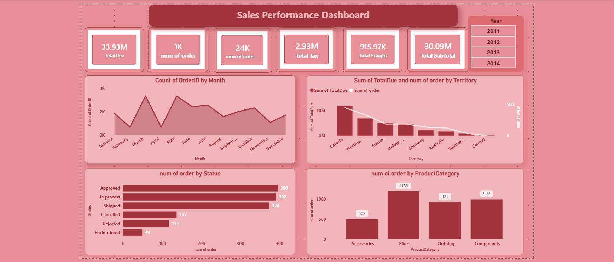
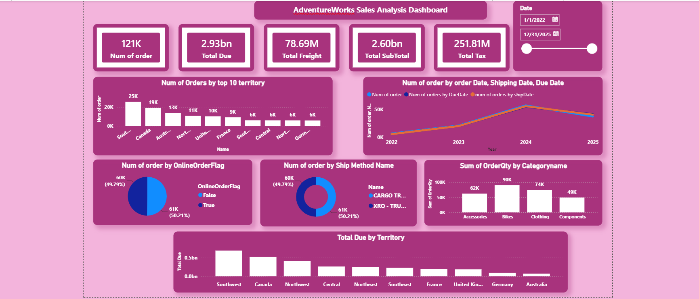
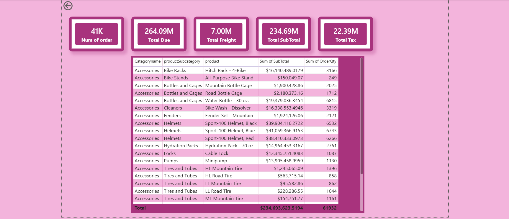
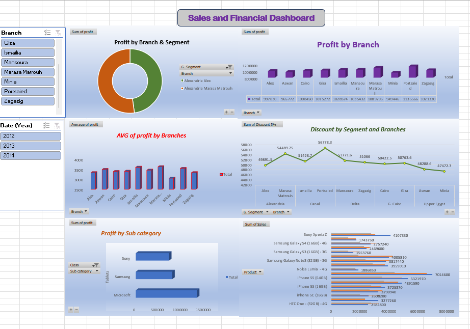
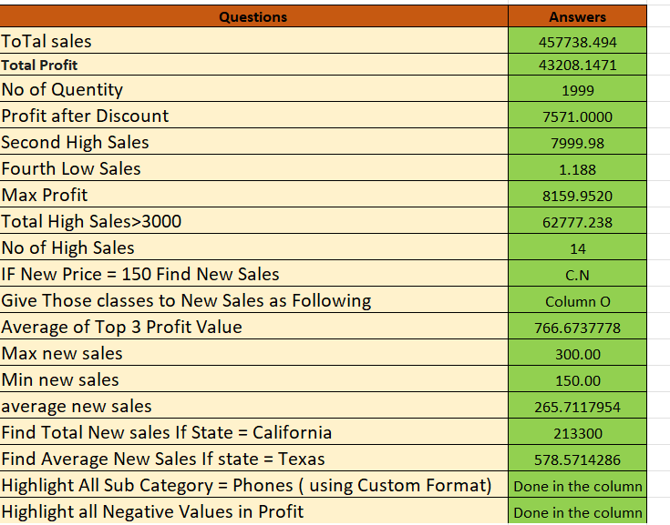

# Data-Analysis
A collection of data analysis projects using Excel, SQL, Power BI, Python to uncover insights and support data-driven business decisions. 

**Sales Performance Dashboard** 
[View Power BI Dashboard](https://drive.google.com/file/d/1YaZT9cgGSyglPQaOPZmQ6xdUn3-VNhIt/view?usp=sharing)

**Tools** Power BI - DAX - Power Query  

**KPIs** 
-Total Due 
-Total Subtotal 
-Total Tax
-Total Freight 
-Num of Orders
-Num of Order Details

**Interactive Tooltip** 
-Num of orders 
-Total Due 
-Total Subtotal by Product Category 

# AdventureWorks Sales Analysis Dashboard | Power BI

## 📊 Project Overview

This project presents an interactive **Sales Analysis Dashboard** built using Microsoft Power BI and the AdventureWorks sample database.

The dashboard provides insights into sales performance, order status, product categories, shipping methods, and sales territories. It helps analyze order trends across different dates and explore business performance through interactive visualizations.

## 🛠️ Tools & Technologies

- **Microsoft Power BI** – Dashboard development and data visualization
- **Power Query (M Language)** – Data transformation, merging tables, and date table preparation
- **DAX** – Measures, calculated tables, and time-based analysis
- **SQL Server** – AdventureWorks data source
- **DirectQuery** – Connectivity mode

## 🗂️ Data Source

The project uses the AdventureWorks sample database provided by Microsoft.

[AdventureWorks Installation and Configuration Guide](https://learn.microsoft.com/en-us/sql/samples/adventureworks-install-configure?view=sql-server-ver15&tabs=ssms)

### Main Tables

- Sales.SalesOrderHeader
- Sales.SalesOrderDetail
- Sales.vSalesPerson
- Sales.SalesTerritory
- Purchasing.ShipMethod
- Production.Product
- Production.ProductSubcategory
- Production.ProductCategory

## 🔄 Data Preparation & Modeling

- Renamed tables and columns for better readability.
- Removed unnecessary columns to optimize the data model.
- Merged Product, Product Subcategory, and Product Category tables using Power Query (M Language). 
- Prepared date fields and added an Order Status classification based on the `ufnGetSalesOrderStatusText` function.
- Calculated Total Due, Tax, and Freight using Power Query or DAX, as appropriate.
- Designed a **Star Schema** to establish clear relationships between fact and dimension tables.
- Created a Product Hierarchy: Category → Subcategory → Product.
- Used `USERELATIONSHIP` to analyze orders by Order Date, Ship Date, and Due Date.

## 📐 DAX Measures

The dashboard includes the following key measures:

- **# Orders** – Total number of sales orders.
- **Total SubTotal** – Total sales subtotal before tax and freight.
- **Total Tax** – Total tax amount.
- **Total Freight** – Total shipping cost.
- **Total Due** – Total amount due for sales orders.
- **# Qty** – Total quantity of products ordered.

A dedicated DAX measures table was created to organize the measures and improve model maintainability.

## 📈 Dashboard Features & Visualizations

### KPI Cards
- Total Orders
- Total SubTotal
- Total Tax
- Total Freight
- Total Due

### Sales Analysis
- Num of Orders by top 10 territory. 
- Num of order by order Date, Shipping Date, Due Date.  
- Num of order by Online Order Flag. 
- Num of order by Ship Method Name. 
- Sum of Order Qty by Category name. 
- Total Due  by Territory. 

### Interactive Features
- **Drill Down:** 
- **Drill Through:** 
- **Report Page Tooltips:** 
- **Date Analysis:** Compare order, shipping, and due-date trends using DAX and `USERELATIONSHIP`.

## 🎯 Key Objectives

- Analyze sales performance and order distribution.
- Monitor order status and shipping performance.
- Identify top-performing product categories and products.
- Compare sales activity across territories.
- Understand the differences between order dates, shipping dates, and due dates.
- Build an interactive and well-structured Power BI data model.

## 📷 Dashboard Preview
 

📊**Sales & Financial Dashboard | Microsoft Excel** 

**##Overview** 
An interactive Excel dashboard that analyzes sales, profit, and discounts across 10 branches in 5 regions (Alexandria, Canal, Delta, Greater Cairo, Upper Egypt) over 2012 to 2014. It also includes a formula-based analysis sheet covering core Excel functions. 

**##Tools** 
-PivotTables 
-Slicers (Branch, Year, Sub category) for interactive filtering 
-Dashboard design (donut, 3D column, line, and bar charts) 
-Formulas: SUM, SUMIF, AVERAGEIF, COUNTIF, LARGE/SMALL, IF (nested), MAX/MIN 
-Conditional formatting and custom number formats 
-Data cleaning and calculated fields (e.g., Discount 5%) 

**##What the dashboard shows** 
-Profit by Branch & Segment: a donut chart comparing the Alexandria branches, with a segment filter 
-Profit by Branch: total profit per branch, ranging from about 949K (Minia) to about 1.14M (Port Said) 
-Average Profit by Branch: shows efficiency per transaction, not just totals 
-Discount by Segment & Branch: a line chart comparing discount cost across regions 
-Profit by Sub-category: Microsoft, Samsung, and Sony tablets 
-Sales by Product and Year: 2012 to 2014 comparison across phone and tablet models 

**##Key figures**
Total profit across all branches: about 10.25M 
Total sales across all products: about 160M 
Top-selling product: Microsoft Surface Pro 2 (about 18M total sales) 

## 📷 Dashboard Preview
 

